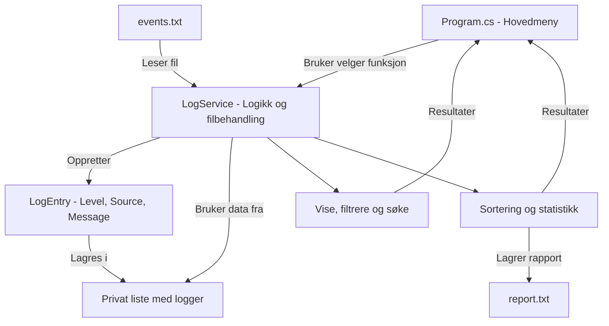

# Planlegging

## Programflyt

Diagrammet er laget med hjelp fra KI. For å forhåndvise det i VS Code, bruk **Ctrl + Shift + V**

## Oppdeling av programmet

**Program.cs**

- Viser menyen og tar imot valg fra brukeren.
- Kaller metodene som trengs for å utføre valgene.
- Viser resultatene i terminalen.

**LogEntry**

- Representerer én loggoppføring.
- Inneholder Level, Source og Message.

**LogService.cs**

- Leser loggene fra events.txt.
- Kontrollerer om loggene har riktig format.
- Lagrer gyldige logger i en privat liste.
- Håndterer filtrering, søk, sortering og statistikk.
- Skriver rapporten til report.txt.
